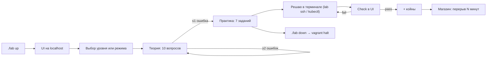
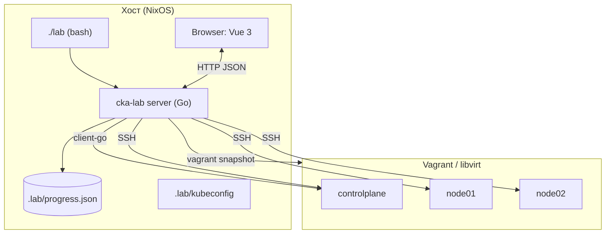

# CKA Lab: дизайн

Дата: 2026-11-07. Статус: черновик, ждёт одобрения.

## Зачем

Я готовлюсь к CKA по курсу KodeKloud (сейчас на Security). Во встроенных лабах курса мало заданий, а пройденные темы забываются. Нужен свой локальный тренажёр с большим объёмом заданий по всем доменам CKA, включая ещё не пройденные. Он должен проверять работу в настоящем kubeadm-кластере и мотивировать игровой механикой.

Типичная сессия на 40 минут: одной командой открыть тренажёр, 15 минут теории, остальное время практика, одной командой всё остановить.

## Цели

- Уровни, как в игре: теория-допуск и 7 практических заданий в кластере.
- Автоматическая проверка практики по состоянию кластера, с понятным pass/fail.
- Койны за задания, бонус за уровень, траты на перерывы.
- Режимы «вперемешку» и «только практика».
- Задания, которые ломают кластер (etcd, upgrade, kubelet), с откатом через snapshot.
- Новое задание или вопрос добавляется файлом, без правки кода.

## Не цели (MVP)

- Аутентификация, несколько пользователей, облако, внешние сервисы.
- Веб-терминал в браузере: работаю в своём терминале.
- Режим экзамена с таймером на 2 часа.
- Push в удалённый репозиторий (его пока нет).

## Анти-цели

- **Задания слишком лёгкие.** Главная анти-цель. Если я решаю уровень, ни разу не открыв документацию, тренажёр провалился. Отсюда правила контента ниже.
- Проверка, которая засчитывает неправильное решение или не засчитывает правильное, сделанное другим способом (`kubectl create` вместо YAML и т. п.).
- Подсказки в условии, которые фактически диктуют команду.
- Стенд, который нужно чинить руками после каждого «ломающего» задания.

## Ограничения среды

- Хост: NixOS unstable, 15 GB RAM, 20 CPU. Go на хосте нет: зависимости через `flake.nix` с `devShell` в проекте, `/etc/nixos` не трогаем.
- Vagrant 2.4.9 + `vagrant-libvirt` 0.12.2. VirtualBox нет. NFS-сервер на хосте не запущен, поэтому synced folder типа `rsync` (только хост → гость).
- Кластер: kubeadm, Kubernetes **v1.37** (версия экзамена по официальной странице LF на 2026-11-07), 1 control-plane (2 CPU, 4 GB) + 2 worker (2 CPU, 2 GB). Хосту остаётся около 7 GB.
- Правила моего skill `vagrant-lab`: машины массивом вверху Vagrantfile, идемпотентные скрипты в `scripts/`, версия одной переменной, swap off, `overlay`/`br_netfilter`, containerd с `SystemdCgroup = true`. В стенде не настраивается то, что является предметом упражнения.
- Весь интерфейс, вопросы и задания на английском, как на экзамене.
- Код целиком пишет Claude.

## Как выглядит работа



## Игровая механика (решения пользователя)

- **Уровень** = одна тема, 10 вопросов теории, затем 7 практических заданий.
- **Теория-допуск:** допустима 1 ошибка. При 2 ошибках и больше порядок вопросов и вариантов перемешивается и блок начинается заново, практика остаётся закрытой. Сданная теория запоминается: при повторном входе в уровень сдавать её снова не нужно.
- **Уровень пройден**, когда решены все 7 практических заданий.
- **Все уровни открыты сразу**, порядок выбирает пользователь.
- **Койны:** за каждое решённое задание; бонус за пройденный уровень; тратятся на перерывы.
- **Режимы:** «Levels» (основной), «Mixed» (задания из всех тем вперемешку), «Practice only» (только практика, без теории).
- **MVP-объём:** 5 уровней, по одному на домен CKA: всего 50 вопросов и 35 практических заданий.

### Решения Claude (можно оспорить)

- Сданная теория уровня сохраняется в прогрессе (см. выше).
- Койны: `easy` 10, `medium` 20, `hard` 30; бонус за уровень 50. В режимах Mixed и Practice only начисляются койны за задания, бонуса нет.
- Против «фарма»: полная награда только за первое решение задания. Повторное решение даёт 30% (округление вниз). Все числа в `config.yaml`.
- Теория: правильный ответ даёт 0 койнов. Награда только за практику, чтобы не перекашивать мотивацию в сторону лёгкого.
- Магазин настраивается в `config.yaml`, по умолчанию: `Break 5 min` за 30, `Break 15 min` за 80, `Break 30 min` за 150. После покупки в UI идёт таймер перерыва, по окончании браузерное уведомление и звук. Койны списываются при покупке и не возвращаются.
- Режим Mixed: вопросы теории и практические задания из всех тем идут вперемешку одним потоком, допуска нет, уровни не учитываются. Practice only: то же, но только практика. В Mixed и Practice only задания с `requiresSnapshot` не выпадают, если пользователь их не включил чекбоксом: откат слишком медленный для потока.

## Контент и правила сложности

Источники:
- `theplatformlab/CKA-Certified-Kubernetes-Administrator` (лицензия MIT): задания можно адаптировать, копирайт сохраняется в `NOTICE`.
- `chadmcrowell/CKA-Exercises` (лицензии нет, значит «все права защищены»): только темы и идеи, текст не копируется.
- Программа CKA (официальная страница LF): Troubleshooting 30%, Cluster Architecture 25%, Services & Networking 20%, Workloads & Scheduling 15%, Storage 10%. Ещё в программе есть Helm, Kustomize, CRD/операторы и Gateway API.

Правила против лёгкости (обязательны для каждого задания):
1. Формулировка в стиле экзамена: что должно получиться, без команд и подсказок «используй `kubectl X`».
2. Внутри уровня сложность растёт: задания 1–2 `medium`, 3–5 `hard`, 6–7 многошаговые `hard` уровня экзамена. Уровень `easy` в MVP не используется.
3. Минимум 3 задания из 7 требуют полей или флагов, которые обычно смотрят в документации (например, `securityContext.capabilities`, `topologySpreadConstraints`, `PV.nodeAffinity`, `etcdctl snapshot` с сертификатами).
4. У каждого задания есть ссылка на нужный раздел kubernetes.io (`docs`). Она видна только после решения или при нажатии «Show solution», так же как и разбор `solution`.
5. «Show solution» до решения: задание засчитывается без койнов.
6. При fail показывается, какая проверка не прошла (`description` проверки) и фактическое значение, но не способ исправления.
7. Теория: вопросы на понимание и детали (поведение, значения по умолчанию, поля), а не «что такое Pod». У каждого вопроса есть `explanation`.

Состав уровней MVP (темы, конкретные задания пишет Claude):

| Уровень | Темы |
|---|---|
| Cluster Architecture | RBAC (Role/ClusterRole, ServiceAccount, `auth can-i`), kubeadm upgrade, etcd backup/restore, Helm, Kustomize, CRD |
| Workloads & Scheduling | Deployments/rollout, ConfigMap/Secret, resources/limits, taints/tolerations, affinity, static pods, HPA |
| Services & Networking | Service types, NetworkPolicy, Gateway API (HTTPRoute), CoreDNS, Ingress |
| Storage | StorageClass, PV/PVC, access modes, reclaim policy, volume в Pod |
| Troubleshooting | сломанный kubelet, control-plane static pod, CrashLoopBackOff, Service без endpoints, узел NotReady, логи |

Security (то, что я сейчас прохожу) входит в несколько уровней: RBAC, `securityContext`, NetworkPolicy.

## Архитектура



### Компоненты

- **`./lab`** (bash, `set -euo pipefail`), точка входа:
  - `lab up`: `vagrant up`, если VM не запущены; забрать kubeconfig и SSH-конфиг; собрать и запустить сервер; открыть браузер.
  - `lab down`: остановить сервер, `vagrant halt`.
  - `lab ssh [node]`: зайти на ноду (по умолчанию controlplane). Там `kubectl` и правильный kubeconfig, как на экзамене.
  - `lab snapshot-base`: сделать базовый snapshot `clean` всех трёх нод (один раз после первого `up`).
  - `lab reset`: откатить все ноды к `clean`.
- **Сервер (Go)**: один бинарник, раздаёт UI через `embed` и JSON API.
- **Frontend**: Vue 3, файл `vue.esm-browser.prod.js` лежит в репозитории, без npm и бандлера. Экраны: список уровней и режимов, теория, практика, магазин и таймер, прогресс.
- **Прогресс**: `.lab/progress.json` (пишется атомарно: временный файл + rename). Каталог `.lab/` в `.gitignore`.

### Доступ к кластеру (решение Claude)

- kubeconfig: `lab up` берёт `/etc/kubernetes/admin.conf` через `vagrant ssh controlplane -c 'sudo cat …'` и пишет в `.lab/kubeconfig` (`chmod 600`). Сервер использует его через `client-go`. В stdout и логи kubeconfig не выводится.
- SSH на ноды: `lab up` сохраняет `vagrant ssh-config` в `.lab/ssh_config`, сервер ходит на ноды через `golang.org/x/crypto/ssh` с этими параметрами. Это нужно для проверок на уровне ноды (файл бэкапа etcd, статус kubelet, версия kubeadm).
- Join workers: bootstrap-токен генерирует Vagrantfile один раз (хранится в `.lab/token`, gitignored) и передаёт в provision-скрипты аргументом. Workers присоединяются с `--discovery-token-unsafe-skip-ca-verification`. Для изолированной учебной сети это приемлемо, через rsync-папку join-команду обратно не передать.

### Проверка практических заданий

Сравнил три варианта:

| Вариант | Плюсы | Минусы |
|---|---|---|
| A. Shell-скрипт с `kubectl` на задание | Просто писать, привычно | Хрупко, трудно тестировать, логика проверок дублируется, ошибки невнятные |
| B. Go-код (`client-go`) на каждое задание | Полная гибкость, тестируемо | Новое задание требует правки кода, а это против требования |
| **C. Декларативные проверки в YAML + движок на Go** | Задание добавляется файлом, движок покрыт тестами, ясные сообщения fail | Нужен набор типов проверок; экзотику закрывает тип `command` |

**Выбран C.** Типы проверок в MVP:

| Тип | Что делает |
|---|---|
| `resource` | Получить объект (apiVersion, kind, namespace, name или labelSelector) через dynamic client и проверить поля по JSONPath. Операторы: `exists`, `notExists`, `eq`, `ne`, `contains`, `matches` (regex), `gte`, `lte`, `count`. |
| `podsReady` | Все Pod по селектору в состоянии Ready, опционально минимальное число. |
| `canI` | `SubjectAccessReview`: может ли субъект (user, group, ServiceAccount) выполнить verb над ресурсом. Для RBAC. |
| `command` | Выполнить команду на ноде по SSH, проверить exit code и/или stdout (`eq`, `contains`, `matches`). Для etcd backup, kubelet, версий, сетевой связности (`kubectl exec … -- wget`). |

Правила движка:
- Проверки выполняются по порядку, все сразу (не останавливаясь на первой ошибке), с таймаутом на каждую (по умолчанию 10 с). Результат: список `{description, pass, actual}`.
- Проверки сравнивают итоговое состояние, а не способ решения, поэтому годится любой путь к результату.
- Для статусов, которые устанавливаются не сразу (Ready, rollout), у проверки есть `retry` на N секунд.

### Изоляция и snapshot

- Обычные задания работают в своём namespace (`ns` в файле задания). При старте задания сервер выполняет `setup`: создаёт namespace и применяет манифесты или команды (например, сломанный Deployment для Troubleshooting). Если namespace уже есть, при старте он пересоздаётся.
- Задание с `requiresSnapshot: true` (etcd restore, upgrade, сломанный kubelet): перед стартом UI предупреждает, что после проверки будет откат. После «Check» (pass) или кнопки «Give up» сервер запускает `vagrant snapshot restore clean` для всех нод. Пока идёт откат, UI показывает статус, и другие задания не стартуют.
- Snapshot делаются сразу для всех трёх нод: при откате только control-plane etcd и workers разойдутся по состоянию.
- Время отката на этом ноутбуке не измерено, его меряем на первом этапе. Если окажется дольше 2 минут, это повод пересмотреть подход.

### Формат контента

```text
content/
  levels/
    workloads/
      level.yaml        # id, title, domain, order
      theory.yaml       # 10 questions
      tasks/
        01-rollout.yaml
        ...
```

Пример задания:

```yaml
id: workloads-03-rollout
title: Rolling update with zero downtime
difficulty: hard
ns: lab-rollout
requiresSnapshot: false
statement: |
  In namespace `lab-rollout` there is a Deployment `api`.
  Update it to image `nginx:1.27.3` so that at no point more than
  one Pod is unavailable and at most two extra Pods are created.
  Record nothing; just make the rollout succeed.
setup:
  manifests:
    - |
      apiVersion: apps/v1
      kind: Deployment
      ...
checks:
  - type: resource
    description: Deployment api uses image nginx:1.27.3
    target: {apiVersion: apps/v1, kind: Deployment, name: api}
    assert:
      - {path: "{.spec.template.spec.containers[0].image}", op: eq, value: "nginx:1.27.3"}
      - {path: "{.spec.strategy.rollingUpdate.maxUnavailable}", op: eq, value: "1"}
      - {path: "{.spec.strategy.rollingUpdate.maxSurge}", op: eq, value: "2"}
  - type: podsReady
    description: All api Pods are Ready
    selector: app=api
    retry: 60s
docs: https://kubernetes.io/docs/concepts/workloads/controllers/deployment/#rolling-update-deployment
solution: |
  kubectl -n lab-rollout patch deploy api ...
```

Пример вопроса:

```yaml
- id: workloads-q04
  question: What happens to a Deployment's Pods when you change only `.spec.replicas`?
  options:
    - A new ReplicaSet is created and a rollout starts
    - The existing ReplicaSet is scaled; no new revision is recorded
    - All Pods are recreated
  answer: 1
  explanation: |
    Scaling does not change the Pod template, so the template hash stays ...
```

При старте сервер валидирует весь контент (схема, уникальные `id`, в уровне ровно 10 вопросов и 7 заданий, известные типы проверок). При ошибке не стартует и пишет файл и поле.

## Стенд (решения Claude)

- Box: `bento/ubuntu-24.04` с провайдером libvirt (проверить наличие на этапе 1; запасной `generic/ubuntu2204`).
- Имена нод: `controlplane`, `node01`, `node02`, как в KodeKloud и на экзамене.
- Сеть: `private_network` 192.168.56.10/11/12, отдельная `libvirt__network_name`.
- CNI: Calico (нужен для заданий с NetworkPolicy, flannel их не поддерживает).
- Провижининг ставит, кроме самого кластера, то, что нужно как окружение заданий, а не как их предмет: `metrics-server`, `local-path-provisioner` (dynamic StorageClass), CRD Gateway API и один Gateway-контроллер, Helm на controlplane, `etcdctl` на controlplane. Gateway-контроллер выбирается на этапе 1: ingress-nginx в 2026 году снят с поддержки, поэтому берётся активно поддерживаемый, например Envoy Gateway.
- `vagrant up`, `destroy` и `snapshot` Claude сам не запускает, только `./lab` по команде пользователя.

## Структура репозитория

```text
flake.nix              # devShell: go, gopls, shellcheck, kubectl, vagrant
lab                    # bash CLI
Vagrantfile
scripts/               # common.sh, controlplane.sh, worker.sh, addons.sh
cmd/cka-lab/main.go
internal/
  content/             # загрузка и валидация YAML
  check/               # движок проверок (resource, podsReady, canI, command)
  cluster/             # client-go, SSH, setup, snapshot
  game/                # теория, койны, магазин, режимы
  progress/            # progress.json
  api/                 # HTTP handlers
web/                   # index.html, app.js, style.css, vendor/vue.esm-browser.prod.js
content/levels/...
config.yaml            # койны, магазин
NOTICE                 # MIT-атрибуция theplatformlab
README.md
```

## Тестирование

- Движок проверок: unit-тесты с fake dynamic client из `client-go` и фейковым SSH-исполнителем, для каждого типа и оператора проверки pass и fail.
- Контент: тест загружает весь `content/` и прогоняет валидацию.
- Игровая логика: допуск теории (0, 1, 2 ошибки), начисление койнов (первое и повторное решение, бонус уровня), покупка в магазине при нехватке койнов.
- API: `httptest` для основных эндпоинтов.
- `shellcheck` для `lab` и `scripts/*.sh`.
- Сквозной прогон на реальном кластере: на каждом этапе пользователь решает задание сам, Claude только указывает команду.

## Этапы (подробный план пишется отдельно)

1. Стенд: `flake.nix`, Vagrantfile, скрипты, `./lab up/down/ssh/snapshot-base/reset`. Готово, когда 3 ноды `Ready`, аддоны работают, время отката измерено.
2. Ядро: загрузка и валидация контента, движок проверок с тестами.
3. Игровая логика и прогресс, API.
4. UI.
5. Контент: 5 уровней × (10 вопросов + 7 заданий), проверка правил сложности.
6. README (запуск, добавление задания), `NOTICE`, финальная сквозная проверка.

## Критерии готовности MVP

- `./lab up` с нуля поднимает кластер (3 ноды `Ready`) и открывает UI; `./lab down` останавливает всё.
- 5 уровней, 50 вопросов, 35 заданий; механика теории, койнов, магазина и трёх режимов работает.
- Задание с `requiresSnapshot` откатывается, после отката кластер здоров.
- `go test ./...` и `shellcheck` проходят.
- В README описаны запуск и добавление задания.

## Что остаётся на усмотрение исполнителя

- Конкретные HTTP-эндпоинты, внутренние типы Go, вёрстка и стили UI.
- Тексты заданий и вопросов в рамках правил сложности.
- Выбор Gateway-контроллера и точные версии аддонов.
